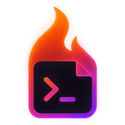
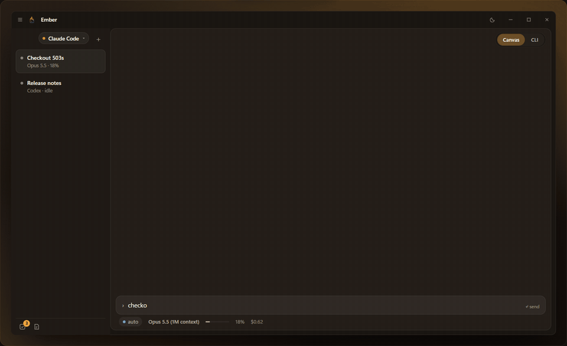

<p align="center"></p>

<h1 align="center">Ember</h1>

<p align="center">A terminal that wraps your agent CLIs in a canvas. A free Windows app for Claude Code, Codex and the other agent CLIs you already use.</p>



**Download:** [ember.deepanswerlabs.com](https://ember.deepanswerlabs.com), or
`Ember-Setup-win-x64.exe` from the [releases page](https://github.com/afetiu/ember-terminal/releases/latest).
The clip above is also an [MP4](docs/media/ember-demo.mp4), and the website plays four more scenarios.

Free · MIT · no account · no telemetry · Windows 10/11 x64

## What it does

- **Answers you can use.** Replies come as readable text with diagrams, tables, charts,
  kanban boards, PDFs, Markdown, spreadsheets, video and live web pages in them. Resize
  them, drag them out and snap them to an edge, or open one full screen and zoom in. The
  words make room, and the pieces stay live as the work goes on.
- **Right-click to ask or to change.** Every object has a menu. Ask a question about it, or
  about the part you clicked, and the answer comes right there without interrupting the
  session. Say what to change instead, and the agent changes it in place.
- **The real CLI's input and menus at the bottom; everything it produces on the canvas.**
  You type into the agent's own prompt, exactly as in any terminal: its `/` commands,
  pickers, permission prompts and queue are its own. The CLI's box is only as tall as that
  prompt and whatever menu or dialog it shows, so the conversation itself — replies, tool
  calls, notices — is drawn on the canvas above. ``Ctrl+` `` gives the CLI the whole tab.
- **Keyboard first.** `Ctrl+↑` walks the objects, `Enter` opens one full screen, `Esc`
  is always the way back, and `Ctrl+K` does the rest.
- **Notes and a todo list, outside sessions.** A sticky note with `Ctrl+Shift+N`, a todo
  list in the sidebar. Every agent can read them, add to them and tick things off.
- **One memory for all your agents.** What one agent learns about you and your projects,
  the others know too. Shared instructions, shared skills.

## Your agents

Ember runs the agent CLIs you already have, each with its own sign-in and its own plan,
exactly as in any other terminal:

**Claude Code · Codex CLI · Gemini CLI · Cursor Agent · OpenCode · Copilot CLI · Qwen Code · Amp · Aider · Crush**

The first run lists the ones you have installed. Every tab starts as a plain terminal
(`+` or `Ctrl+Shift+T`). Run `claude` or `codex` in it and the tab becomes that agent's
canvas above the agent's real CLI: you type into its own prompt at the bottom, and its
replies are drawn on the canvas. Exit the agent and the tab is a terminal again. `Ctrl+K` › **New Claude tab** opens a terminal that starts
`claude` by itself.

Claude Code and Codex get the canvas: their replies, tool calls and objects are read from
their own session logs. Everything else (permission prompts, questions, plan approval,
`/` menus, pickers, the queue) stays in their own CLI, so Ember never has to keep a copy of
it up to date. The others run in their own screen, with Ember's tools available to them. How each CLI is run lives in `src/shared/agents.ts`.

## Install

Download the installer from [ember.deepanswerlabs.com](https://ember.deepanswerlabs.com) or
the [releases page](https://github.com/afetiu/ember-terminal/releases/latest). There is a
portable `.zip` and `.tar.gz` too. It installs for your user only, with no admin prompt.

Or from a terminal, which installs or updates to the latest release, checks it against the
release's checksums, and starts Ember:

```powershell
# PowerShell
irm https://ember.deepanswerlabs.com/install.ps1 | iex

# cmd
powershell -NoProfile -ExecutionPolicy Bypass -Command "irm https://ember.deepanswerlabs.com/install.ps1 | iex"
```

From 1.4.5 Ember updates itself: it looks for a new release every hour, and when one is out
the version at the bottom of the sidebar becomes **Update to …**; click it, then
**Restart to update**.

**Not code signed yet.** Windows SmartScreen may warn the first time: choose **More info**,
then **Run anyway**. Every release is built from this repository by GitHub Actions and
ships with `SHA256SUMS.txt` so you can check the file (see [CODE_SIGNING.md](CODE_SIGNING.md)).

Ember replaces the window, not your shell. It runs PowerShell 7 through ConPTY, the way
Windows Terminal does, so your profile, modules, oh-my-posh and PSReadLine work as before.

## Working on the canvas

- **Type in the CLI** at the bottom: it is the agent's own prompt. The current turn fills
  the canvas; earlier turns are a step away with `Ctrl+Shift+↑` / `↓`, or keep scrolling
  past the top or bottom.
- **The CLI sizes itself** to the agent's own bottom area: the prompt box and its footer at
  rest, plus the working line, the queue or the todo list while a turn runs, and the whole
  picker, permission prompt, question, `/` list or long prompt while one shows. It grows
  the moment that area needs more rows and shrinks back once it needs fewer; there is no
  divider to drag. ``Ctrl+` `` shows the full CLI, conversation and all, and back.
- **Objects in a reply** resize from any edge. **Drag out** takes one out of the reply:
  drop it anywhere, or at an edge to snap it there (up to four per edge, each where you drop
  it), and the text moves out of the way.
- **Full screen** has a zoom bar. `Ctrl` + wheel or a pinch zooms toward the pointer,
  `+` / `−` / `0` from the keyboard, and a double-click zooms to 2×.
- **The plan** of a longer piece of work is an object like the others: it ticks itself off, follows
  the work into later turns, and can be moved, snapped, minimized or removed.
- **Subagents** show as pills while they work. Click one to see the steps it took.
- **Pictures:** `Ctrl+V` an image (or drop one) and the agent attaches it as
  `[Image #1]`; the canvas shows its thumbnail just above the CLI until you send, then
  in your turn.
- **Questions** a reply ends with get their options as buttons and a field each; **Send**
  types the answers into the agent's prompt as one message.

| Keys | With an object selected (`Ctrl+↑` from the CLI) |
| --- | --- |
| `↑` `↓` | Choose another object |
| `Enter` | Full screen |
| `P` | Place it on screen, or put it back |
| `Shift` + arrows | Snap to that edge |
| `M` | Minimize |
| `N` | New sticky note |
| `Space` | Its menu |
| `Del` | Remove |
| `Esc` | Back to typing |

`F1` shows every shortcut in the app.

## Notes, todos and shared knowledge

- **Notes** are Markdown files in `Documents\Ember Notes`. Edit them in Ember or in any
  editor. A sticky note from a session is a real note too, with the date and the session.
- **Todo** is one list, `Todo.md` in the same folder (`Ctrl+Shift+D`). An item can be
  handed to a new session as its task.
- **Agents use both** through Ember's tools: "add a todo: rebuild the website", "what's in
  my notes about the release?"
- **Shared knowledge:** instructions in `~/.ember/brain/instructions.md`, one fact per file
  in `~/.ember/brain/memory`, and shared skills, handed to every agent Ember finds. Settings
  › Agent › Shared knowledge shows what is shared and turns it off.

## Everything else

- `Ctrl+K` is the command line for everything Ember can do. The same commands work from
  any shell as `ember`: `ember new`, `ember split right`, `ember set font.size 14`…
- Under every session is a real PowerShell, with command blocks, splits
  (`Alt+Shift+` `+` / `−`), find in scrollback and a task runner.
- Nine looks to pick from: Basalt, Smoke, Lacquer, Patina, Hearth, Lamp, Snowfall, Tide and Terrarium. Each has its own colours and faces, and a background that moves slowly. Settings › Theme, or `ember theme <name>`.
- `Ctrl+,` opens Settings: text size and spacing, motion, agents, sound.
- Notes, todos and settings are plain files in your user folder. Your work goes where your
  agent CLI already sends it; Ember adds no account and no telemetry.

## Network

Ember makes these calls itself. Everything else is the agent CLI you run in it.

- **Update check:** asks GitHub's releases API for the latest version at start, every hour,
  and when you come back to the window after half an hour. GitHub sees your IP address and Ember's version. Settings › Behaviour › Check
  for updates turns it off; clicking the version in the sidebar still checks.
- **Plan usage:** polls `api.anthropic.com` every minute with Claude Code's own login, only
  while Settings › Agent › Plan usage is on. Off by default.
- **Images in agent replies:** an image from the internet loads only when you click it.

Pasted and pushed images live in `%TEMP%\ember-<pid>` and are deleted when Ember quits.
More in the [privacy policy](CODE_SIGNING.md#privacy-policy).

The full guide is at [ember.deepanswerlabs.com/docs](https://ember.deepanswerlabs.com/docs).

## Building from source

```bash
pnpm install
pnpm dev       # hot-reloading app
pnpm build     # typecheck + bundle to out/
pnpm dist      # -> release/Ember-Setup-win-x64.exe (+ Ember-win-x64.zip, .tar.gz)
```

If `electron.exe` is missing after install, run `node node_modules/electron/install.js`
(pnpm does not run that package's install script by default).

Releasing and the website are two steps. A `v*` tag builds the installer and attaches it
to a GitHub Release; the site's download buttons follow the latest release
(`site/_redirects`). The site (`site/`, ember.deepanswerlabs.com) is a Cloudflare Pages
project that is not connected to this repository, so publish it with `pnpm site:deploy`
after a `wrangler login`.

`node scripts/demo/record-site-demo.mjs [scene]` records the clip at the top of this page
from the website's own demo (needs Edge and `ffmpeg`).

```
src/main/       Electron main: ConPTY host, agents, the bridge and MCP tools
src/preload/    contextBridge -> window.ember
src/renderer/   the canvas, sessions, sidebar, notes, todo, settings
resources/      the MCP servers and CLIs Ember hands to every agent and shell
site/           the website
```

How session status is read off the terminal, what the window glass costs, performance
measurements and the traps found on the way are in
[docs/engineering-notes.md](docs/engineering-notes.md). See [CONTRIBUTING.md](CONTRIBUTING.md)
to help.

## License

[MIT](LICENSE). Made by [Deep Answer Labs](https://deepanswerlabs.com). Claude Code, Codex,
Gemini CLI, Cursor Agent, OpenCode and GitHub Copilot CLI are trademarks of their owners;
Ember isn't affiliated with any of them.
